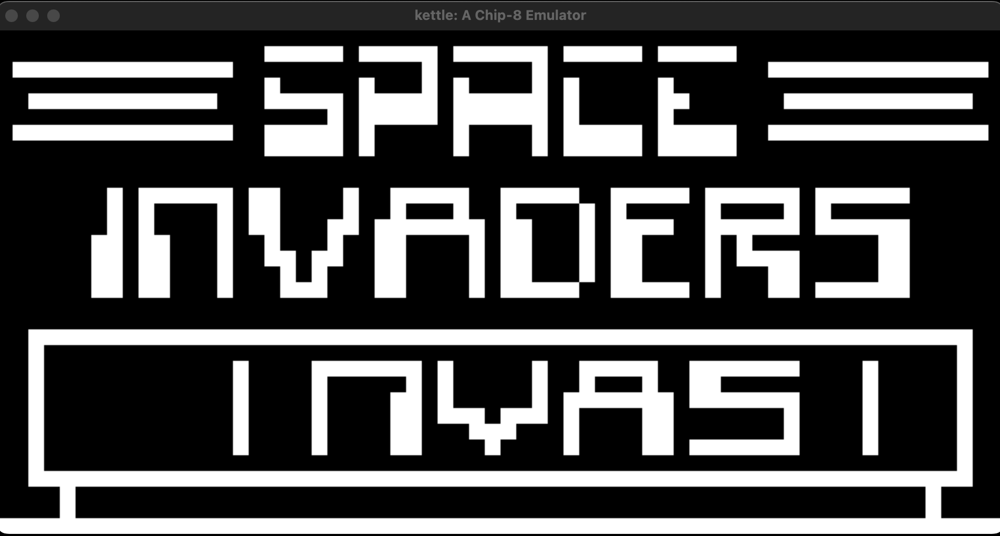

# kettle

A CHIP-8 emulator written in Rust with an SDL2 frontend.



## Features

- Full CHIP-8 instruction set
- 64x32 display, scaled 15x
- Keyboard mapped to the 16-key hex keypad
- 60Hz delay and sound timers
- Square-wave beep while the sound timer is active
- Emulator core separated from the frontend

## Components

### Core (`kettle_core`)

The core has no window, audio, or graphics dependencies. The frontend feeds it ROM bytes and key state, and reads back the display and sound state.

**State (`Emu`)**

- **RAM**: 4096 bytes. The font is stored at `0x000` and programs are loaded at `0x200`.
- **Registers**: sixteen 8-bit registers (`V0` to `VF`) and a 16-bit index register (`I`). `VF` doubles as the carry, borrow, and collision flag.
- **Program counter (`pc`)**: the address of the next instruction.
- **Stack and stack pointer**: 16 return addresses, used by call (`2NNN`) and return (`00EE`).
- **Display**: a 64x32 array of on/off pixels.
- **Keys**: the pressed state of the 16 keypad keys.
- **Timers**: a delay timer and a sound timer, each counting down at 60Hz.

**Methods**

- `new()` and `reset()`: set up a fresh emulator with the font loaded.
- `load(&[u8])`: copies a ROM into RAM starting at `0x200`.
- `tick()`: runs one instruction by fetching, decoding, and executing it.
- `tick_timers()`: decrements the delay and sound timers. Call it once per frame.
- `get_display()`: returns the pixel buffer.
- `keypress(idx, pressed)`: sets the state of one key.
- `sound_active()`: returns true while the sound timer is above zero.

**Instruction cycle**

1. **Fetch**: reads two bytes at `pc` and combines them into a 16-bit opcode, then advances `pc` by 2.
2. **Decode**: splits the opcode into four 4-bit digits and matches on them.
3. **Execute**: runs the matching instruction, updating registers, memory, display, or `pc`.

### Frontend

- **Window and renderer**: an SDL2 window with a canvas, 15 pixels per CHIP-8 pixel.
- **Event loop**: polls SDL events once per frame and handles quit, `Esc`, and key presses.
- **Key mapping**: `key2button` converts keyboard keys to keypad indexes.
- **Draw**: `draw_screen` clears the canvas and fills a rectangle for each lit pixel.
- **Audio**: `SquareWave` generates a 440 Hz tone, and SDL calls it on its audio thread whenever it needs samples. The audio device plays while `sound_active()` is true and pauses otherwise.
- **Main loop**: each frame runs 10 instructions, ticks the timers once, updates the audio, and draws.

## Requirements

- Rust (stable)
- SDL2, installed on your system or built from source with the `bundled` feature (needs `cmake`)

On macOS:

```
brew install sdl2
```

To build SDL2 from source instead, set this in `frontend/Cargo.toml`:

```toml
sdl2 = { version = "0.37", features = ["bundled"] }
```

If CMake 4.x fails with a policy error, prefix the build with `CMAKE_POLICY_VERSION_MINIMUM=3.5`.

## Run

```
cargo run path/to/game.ch8
```

## Controls

```
CHIP-8        Keyboard
1 2 3 C       1 2 3 4
4 5 6 D       Q W E R
7 8 9 E       A S D F
A 0 B F       Z X C V
```

Press `Esc` to quit.

## Speed

The frontend runs 10 instructions per frame at vsync, about 600 instructions per second on a 60Hz display. Change `TICKS_PER_FRAME` in `frontend/src/main.rs` to speed games up or slow them down.

## Implementation notes

- 4096 bytes of RAM, programs loaded at `0x200`, font at `0x000`
- `8XY6` and `8XYE` shift `VX` in place and ignore `VY`
- `FX55` and `FX65` leave `I` unchanged
- `DXYN` wraps each pixel around the screen edges

## Resources

- [The Rust Programming Language](https://doc.rust-lang.org/book/)
- [Cowgod's CHIP-8 Technical Reference](http://devernay.free.fr/hacks/chip8/C8TECH10.HTM)
- [Timendus's CHIP-8 test suite](https://github.com/Timendus/chip8-test-suite)
